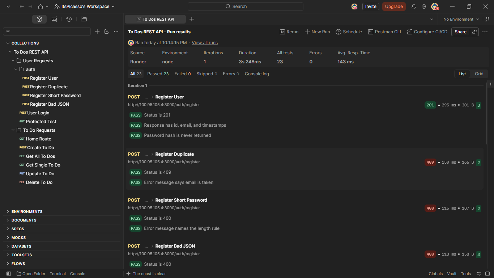
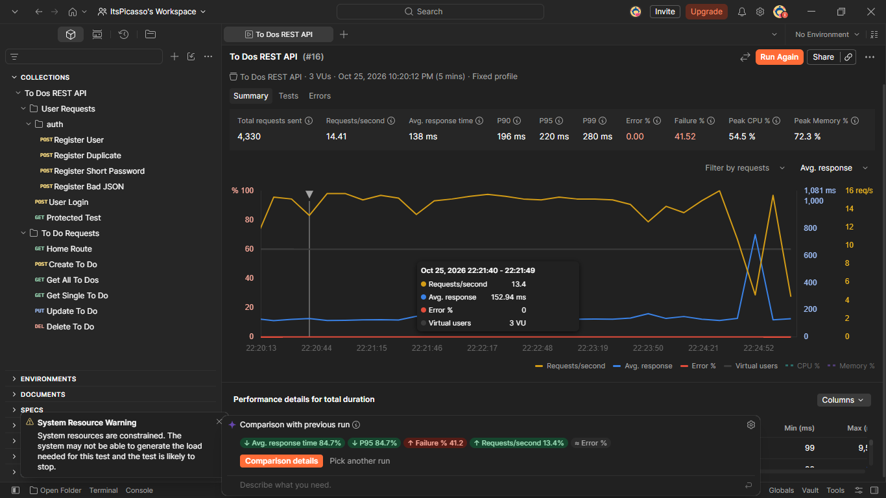

# go-gin-todo-api

A todo API in Go with user accounts. Each user only sees their own todos.

Built with Gin and PostgreSQL.

## Setup

You need Go, PostgreSQL, and the golang-migrate CLI.

1. Create a database and user in PostgreSQL.

2. Copy the example env file and fill it in:

   ```
   cp .env.example .env
   ```

   For `JWT_SECRET`, generate a value with `openssl rand -hex 32`.

3. Run the migrations:

   ```
   ./scripts/migrate.sh up
   ```

4. Start the server:

   ```
   go run ./cmd/api
   ```

The server listens on `PORT`, which defaults to 3000.

## Environment

| Variable       | Required | Notes                              |
|----------------|----------|------------------------------------|
| `DATABASE_URL` | yes      | PostgreSQL connection string       |
| `PORT`         | no       | Defaults to 3000                   |
| `JWT_SECRET`   | yes      | Signs login tokens. Keep it private. |

## Endpoints

Routes marked auth need the header `Authorization: Bearer <token>`.

| Method | Path              | Auth | Responses                                |
|--------|-------------------|------|------------------------------------------|
| GET    | `/`               | no   | 200                                      |
| POST   | `/auth/register`  | no   | 201, 400 bad body or short password, 409 email taken |
| POST   | `/auth/login`     | no   | 200 with token, 400 bad body, 401 wrong credentials |
| POST   | `/todos`          | yes  | 201, 400 bad body, 401                   |
| GET    | `/todos`          | yes  | 200, 401                                 |
| GET    | `/todos/:id`      | yes  | 200, 400, 401, 404                       |
| PUT    | `/todos/:id`      | yes  | 200, 400, 401, 404                       |
| DELETE | `/todos/:id`      | yes  | 200, 400, 401, 404                       |

## Example

Register, then log in to get a token:

```
curl -s -X POST http://localhost:3000/auth/register \
  -H "Content-Type: application/json" \
  -d '{"email":"you@example.com","password":"secret123"}'

curl -s -X POST http://localhost:3000/auth/login \
  -H "Content-Type: application/json" \
  -d '{"email":"you@example.com","password":"secret123"}'
```

Create a todo with that token:

```
curl -i -X POST http://localhost:3000/todos \
  -H "Authorization: Bearer <TOKEN>" \
  -H "Content-Type: application/json" \
  -d '{"title":"Buy coffee"}'
```

## Migrations

```
./scripts/migrate.sh up              apply pending migrations
./scripts/migrate.sh down 1          roll back one migration
./scripts/migrate.sh create <name>   create a new migration pair
./scripts/migrate.sh force <version> reset a dirty version after a failed run
```

Migration 3 deletes existing rows in `todos` before adding `user_id`.

## Project layout

```
cmd/api/               entry point and routes
internal/config/       environment loading
internal/database/     connection pool
internal/handlers/     HTTP handlers
internal/middleware/   JWT auth
internal/models/       structs
internal/repository/   SQL
migrations/            SQL migrations
scripts/migrate.sh     migration helper
```

## Testing

The API was tested with Postman. The functional run executes all 23 requests in order, covering registration, login, and each todo operation, including expected failure cases such as a duplicate email, a short password, and malformed JSON.



The load test used a fixed profile of 3 virtual users for 5 minutes, running the full collection against the server in the Docker container.


